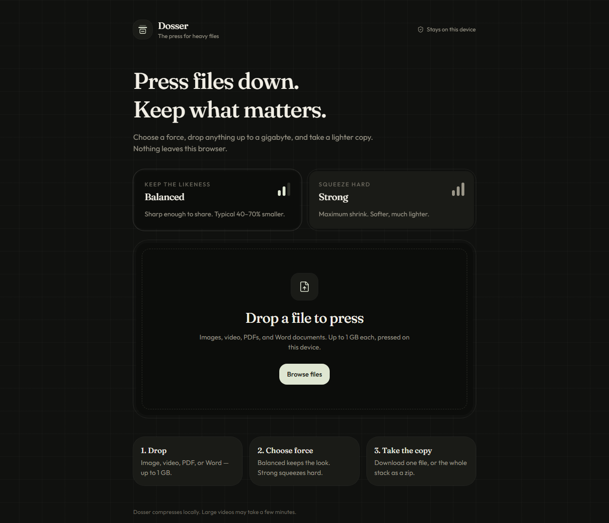

# Dosser

[](https://github.com/Zaheer-verse/dosser/actions/workflows/ci.yml)
[](LICENSE)

**Press files down. Keep what matters.**

Dosser is a browser file compressor for images, videos, PDFs, and Word documents. Choose Balanced or Strong compression, add a stack of files, and download lighter copies individually or together as a ZIP. File contents are processed on your device; the compression flow does not upload them to a server.



## Features

- Drag and drop, browse, or paste files into a queue.
- Two compression presets with per-file progress, size comparisons, and error messages.
- Local image resizing and encoding, video transcoding, PDF rendering, and DOCX optimization.
- Single-file downloads and a prepared ZIP for the completed stack.
- Retain the original file when a compressed candidate is larger.
- Responsive interface for desktop and mobile browsers.
- No account, API key, or database required for the app's compression features.

## Using the app

1. Select **Balanced** for higher fidelity or **Strong** for smaller output.
2. Add supported files, then start the press.
3. Download a completed file from its card. For several files, prepare the ZIP first, then click its download button once it is ready.

Preparing an archive is asynchronous. A separate download click preserves the browser's user activation, which embedded and mobile browsers can require. A single-file download uses the browser's normal download handling. Its destination depends on the device and browser settings; the app cannot confirm where the operating system saves it.

The queue lives in memory. Download anything you want to keep before refreshing or closing the page.

## Format support and limitations

| Type           | Processing                                                       | Important limitations                                                                                                                                        |
| -------------- | ---------------------------------------------------------------- | ------------------------------------------------------------------------------------------------------------------------------------------------------------ |
| Images         | Browser decoding, resizing, and canvas encoding                  | Decoding depends on the browser. Formats such as HEIC and TIFF may fail even when their extension is accepted. Re-encoding may remove metadata or animation. |
| Videos         | Mediabunny with browser encoders; MP4 or WebM output             | Available codecs, performance, and audio encoding vary by browser and device. Large videos may take several minutes.                                         |
| PDFs           | PDF.js renders pages; pdf-lib creates a new PDF from page images | Output is rasterized. Searchable text, selectable text, forms, links, accessibility tags, and other interactive document features are not preserved.         |
| Word documents | Recompress DOCX contents and optimize embedded images            | Only `.docx` is supported. Image decoding and the document's existing compression affect potential savings. Review the result before replacing an original.  |

The input limit is **1 GiB per file** (displayed as 1 GB in the interface). This is an acceptance limit, not a guarantee that every device can process a file that large. Decoded images, video frames, PDF pages, and ZIP creation can use considerably more memory than the source file. Smaller batches are more reliable on mobile devices. Compression is lossy where applicable, and savings are not guaranteed.

Use a current browser. Video transcoding depends on browser codec APIs and may require a secure context. Browser or embedded-preview policies can also affect downloads. Keep original documents until you have checked their downloaded copies.

## Development

### Requirements

- Node.js **22.13 or newer** (CI uses Node 22).
- npm and a current browser.

```sh
npm ci
npm run dev
```

The development script starts the application on port 8080. Always use the npm scripts: they load the committed, non-secret `.grok/app-env.json` configuration through `scripts/with-app-env.mjs`. Authentication and database deployment are disabled for this app.

### Commands

| Command                                  | Purpose                                                                                                                |
| ---------------------------------------- | ---------------------------------------------------------------------------------------------------------------------- |
| `npm run dev`                            | Start the development app.                                                                                             |
| `npm run build`                          | Generate the production build and run the platform's migration hook. No database configuration is needed for this app. |
| `npm run preview`                        | Serve the built output for local verification.                                                                         |
| `npm run typecheck`                      | Check TypeScript without emitting files.                                                                               |
| `npm test`                               | Run the existing platform and helper regression tests.                                                                 |
| `npm run test:downloads`                 | Run file-download and ZIP regression tests.                                                                            |
| `npm run test:browser -- <loopback-url>` | Verify real browser file and ZIP downloads against a running app.                                                      |
| `npm run lint`                           | Run the repository ESLint configuration.                                                                               |
| `npm run format`                         | Format files with Prettier.                                                                                            |

`startup.sh` remains the Linux App Builder entrypoint. On Windows, `startup.ps1` starts the development app in a hidden background process and skips starting another copy when one is already running. `npm run preview:restart` and `npm run preview:stop` manage the built-output preview on Linux and Windows; on Windows they refuse to stop an unrelated process using the preview port. `npm run preview` also works as a foreground preview command.

### Project structure

```text
src/
  components/       Upload area, file cards, controls, and app shell
  lib/compress/     Image, video, PDF, and DOCX processors
  lib/download.ts   Browser download handling
  lib/archive.ts    ZIP creation and filename handling
  routes/           TanStack Router pages and document shell
  store/queue.ts    In-memory compression queue
public/             Static assets and platform install resources
scripts/            Build, environment, test, and platform helpers
server/             Platform middleware
.github/            CI and contribution templates
```

The UI uses React 19, TypeScript, TanStack Start/Router, Tailwind CSS, Zustand, and Lucide. File processing uses JSZip, PDF.js, pdf-lib, and Mediabunny. Existing platform auth, connector, and database helpers are included in the source tree; the compressor does not enable those integrations.

## Validation

GitHub Actions runs dependency installation, the existing tests, download regression tests, TypeScript checks, the production build, and Chromium download checks on pushes and pull requests. Dependabot checks npm dependencies and GitHub Actions weekly, with at most five open update pull requests per ecosystem.

To run the browser regression locally, install Chromium once, start a production preview after building, then target that running preview:

```sh
node node_modules/playwright/cli.js install chromium
npm run build
npm run preview
```

Run the check from a separate terminal while the preview is serving:

```sh
npm run test:browser -- http://127.0.0.1:8081/
```

The browser check accepts loopback URLs only and writes its artifacts within the repository. For manual verification, process a non-sensitive file, download it, inspect its bytes, then prepare and download a multi-file ZIP. Check duplicate filenames and repeat at a mobile viewport and in the intended embedded host.

## Deployment

The existing Vite/Nitro configuration targets Vercel, and `vercel.json` retains the App Builder installation contract. This repository does not include credentials or a live deployment URL. Preserve the platform middleware, PWA plugin, preview bridge, and `public/__grok` resources when changing deployment settings. The file-compression features do not need server secrets.

## Contributing and security

See [CONTRIBUTING.md](CONTRIBUTING.md) for the development workflow, [SECURITY.md](SECURITY.md) for responsible reporting, and [CHANGELOG.md](CHANGELOG.md) for changes. Do not attach private documents or sensitive file contents to public issues.

## License

Dosser is licensed under the [MIT License](LICENSE). Dependencies remain subject to their respective licenses.
